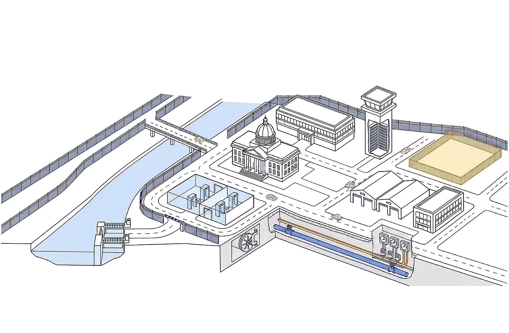
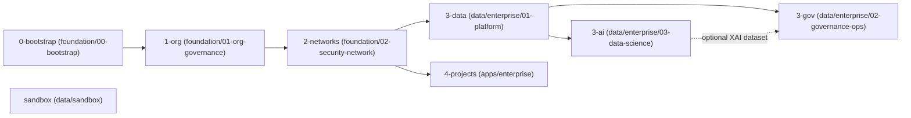
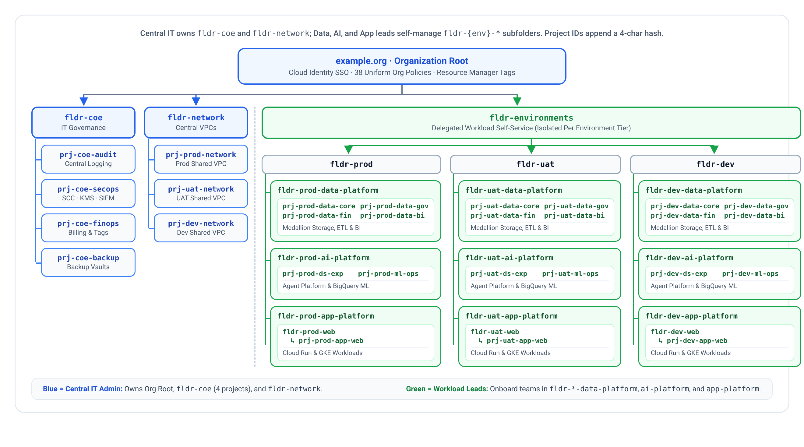

[00 Launchpad](https://github.com/choo737/gcp-launchpad) · **01 Foundation** · [02 Ingestion](https://github.com/choo737/gcp-data-ingestion) · [03 Medallion](https://github.com/choo737/gcp-data-medallion) · [04 Data Science](https://github.com/choo737/gcp-data-science)

# GCP Foundation

Deploy folders, 38 Org Policies, Shared VPC, KMS, SCC, and Medallion foundations with Terraform.
Supports new greenfield organizations, brownfield `fldr-<env>-data-platform` folders, and single-project sandboxes.



## Quick Orientation

Import optional `platform-context.json` from [gcp-launchpad](https://github.com/choo737/gcp-launchpad) or start directly with [QUESTIONNAIRE.md](QUESTIONNAIRE.md).

| Consumes From | Deploys | Hands Off To | Standalone Ready? |
| --- | --- | --- | --- |
| Optional `platform-context.json` or [QUESTIONNAIRE.md](QUESTIONNAIRE.md) | Folders, 38 Org Policies, Shared VPC, KMS, SCC, BigQuery, Apps | `00_linked.auto.tfvars.json` and `foundation-outputs.json` | Yes (`Path 0`..`Path 3`) |

## Start in 3 Steps

1. **Create your private repository** (GitHub forces standard forks of public repos to stay public):

```bash
gh repo create example-org/gcp-foundation --private --template choo737/gcp-foundation --clone
cd gcp-foundation
gh repo view --json isPrivate --jq '.isPrivate'
```

Confirm `gh repo view` prints `true` before saving `custom.auto.tfvars` or `envs/<env>.tfvars`.

2. **Run with your AI coding agent** (`Claude Code`, `OpenAI Codex`, `Gemini CLI`, or `Antigravity`):

```text
Read AGENTS.md, QUESTIONNAIRE.md, and .agents/skills/setup-customer-foundation/SKILL.md.
Check platform-context.json, confirm Path 0-3, and write gitignored custom.auto.tfvars or envs/<env>.tfvars.
```

3. **Verify locally**:

```bash
make fmt-check
make validate
make test
```

## Platform Districts

| Repository | District & Layer | Core Capabilities | Status |
| --- | --- | --- | --- |
| [gcp-launchpad](https://github.com/choo737/gcp-launchpad) | `00` City Planning Hub | Intake Q&A, preflight check, and Brownfield bridge | Active |
| **gcp-foundation** *(this repo)* | `01` Governance & Utilities | Folders, 38 Org Policies, Shared VPC, VPC-SC, KMS, and SCC | Active |
| [gcp-data-ingestion](https://github.com/choo737/gcp-data-ingestion) | `02` Entry Ports & Bridges | Pub/Sub + DLQ, Datastream CDC, Cloud Run jobs, and Workflows | Active |
| [gcp-data-medallion](https://github.com/choo737/gcp-data-medallion) | `03` Warehouses & Quality | BigQuery Bronze/Silver/Gold, Dataform, and Knowledge Catalog | Active |
| [gcp-data-science](https://github.com/choo737/gcp-data-science) | `04` Offices, AI & Homes | Agent Platform, BigQuery ML, TreeSHAP XAI, and WORM ledger | Active |
| `gcp-webapp` *(Planned)* | Hosted App Template | HTTPS Load Balancer, Cloud Armor, Cloud Run, and Cloud SQL | Roadmap |
| `gcp-adk-agent` *(Planned)* | Hosted Agent Template | Google ADK on Agent Runtime or Cloud Run with eval gates | Roadmap |

## Technical Reference

<details open>
<summary><strong>1. Architecture, Mermaid Flow & 2026 Product Naming</strong></summary>

`gcp-foundation` separates bootstrap, org governance, networking, data storage, AI isolation, and application factories.





| Path | Target Scope | Stage Sequence |
| --- | --- | --- |
| Path 0: Bootstrap | Existing seed project | `foundation/00-bootstrap` |
| Path 1: Greenfield | Org or top folder | `01-org-governance` -> `02-security-network` -> `01-platform` -> `03-data-science` -> `02-governance-ops` -> `apps/enterprise` |
| Path 2: Brownfield | Existing `fldr-<env>-data-platform` folder | `01-platform` -> `03-data-science` -> `02-governance-ops` -> `apps/enterprise` |
| Path 3: Sandbox | One existing GCP project | `data/sandbox` |

- **7-Team & App Factory**: Maps `foundation_iam_groups`, `department_budgets`, `prj-coe-secops`, and `applications` into `apps/enterprise`.
- **Stage Linking**: Chains outputs via `scripts/link-stages.sh` into `00_linked.auto.tfvars.json` or GCS `foundation-outputs.json`.
- **2026 data names**: Uses Knowledge Catalog (formerly Dataplex), BigQuery Policy Tags, and Workflows (formerly Cloud Workflows).
- **2026 AI names**: Uses Agent Platform (formerly Vertex AI) and Agent Runtime (formerly Vertex AI Agent Engine).

</details>

<details open>
<summary><strong>2. Prerequisites, Keyless WIF CI/CD & Cost Guardrails</strong></summary>

Select a `team_size_tier` (`S`, `M`, or `L`) matching your engineering teams and separation rules.

| Tier | Profile | CI Identity Scope | GitHub Plan Gating |
| --- | --- | --- | --- |
| `S` | Small pilot (`1-5` engineers) | Single deployer WIF SA across stages | `github_free` branch rules |
| `M` | Growth (`5-20` engineers) | Scoped `tf_foundation_ci`, `tf_ingestion_ci`, `dataform_ci` | `github_team` `CODEOWNERS` reviews |
| `L` | Regulated SoD + Vendor Split | Per-stage SAs (`org_gov_ci`, `net_sec_ci`, `data_plat_ci`, `tf_app_ci`) | `github_enterprise` Environment Reviewers |

| GitHub Variable | Purpose | Stage Source |
| --- | --- | --- |
| `GCP_WIF_PROVIDER` | Keyless GitHub OIDC provider resource name | `foundation/00-bootstrap` |
| `GCP_WIF_SERVICE_ACCOUNT` | Default Terraform deployer SA (`S` tier) | `foundation/00-bootstrap` |
| `GCP_ORG_GOV_WIF_SA`, `GCP_NET_SEC_WIF_SA` | Scoped Stage `01` and Stage `02` SAs (`L` tier) | `foundation/00-bootstrap` |
| `GCP_DATA_PLAT_WIF_SA`, `GCP_APP_WIF_SA` | Scoped Data Platform and `apps/enterprise` SAs | `foundation/00-bootstrap` |
| `GCP_TFSTATE_BUCKET`, `IAC_OUTPUTS_BUCKET` | Hardened GCS state and `foundation-outputs.json` buckets | `foundation/00-bootstrap` |

- **Zero-idle baseline**: Serverless `dev`, `uat`, and `0` baseline `prod` slots cost `$0/mo` idle.
- **Optional paid add-ons**: `100` baseline slots cost `$5,365.50/mo`; `enable_ngfw_enterprise` adds `$2,555/mo/env` plus inspection.
- **CI checks**: `.github/workflows/ci.yml` runs `make fmt-check`, `make validate`, and `make test` offline.
- **CD promotion**: `.github/workflows/terraform-deploy.yml` promotes `shared`, `dev`, `uat`, and `prod` via WIF.

</details>

<details open>
<summary><strong>3. Repository Layout, Agent Skills & Day-0 to Day-2 Guides</strong></summary>

### Antigravity or OpenAI Codex

```text
Read AGENTS.md, QUESTIONNAIRE.md, and .agents/skills/setup-customer-foundation/SKILL.md.
Check platform-context.json first, confirm Path 0-3, and write gitignored custom.auto.tfvars or envs/<env>.tfvars.
```

### Claude Code

```text
Read CLAUDE.md, QUESTIONNAIRE.md, and .agents/skills/setup-customer-foundation/SKILL.md.
Create a private template repo first, link stages with scripts/link-stages.sh, and verify Dataform and Knowledge Catalog scans.
```

| Skill | File | Purpose |
| --- | --- | --- |
| `setup-customer-foundation` | `.agents/skills/setup-customer-foundation/SKILL.md` | Full private repo onboarding, intake, linking, and verification |
| `choose-entry-point` | `.agents/skills/choose-entry-point/SKILL.md` | Select Path 0-3 based on permissions and landing zone |
| `add-data-domain` | `.agents/skills/add-data-domain/SKILL.md` | Add Gold domain projects and re-link `02-governance-ops` |
| `add-workload-pillar` | `.agents/skills/add-workload-pillar/SKILL.md` | Onboard workload folders across `environments` or `parent_id` |
| `drift-safe-apply` | `.agents/skills/drift-safe-apply/SKILL.md` | Link outputs, inspect plans, and import existing resources |

### Repository Layout

- `README.md`, `QUESTIONNAIRE.md`, `AGENTS.md`, `CLAUDE.md`, `CODEOWNERS`, `Makefile`: Suite entry and review files.
- `foundation/`: Stages `00-bootstrap`, `01-org-governance`, and `02-security-network` with `envs/` templates.
- `data/`: `data/sandbox/` and `data/enterprise/` (`01-platform`, `02-governance-ops`, `03-data-science`).
- `apps/`: `apps/enterprise/` per-environment application workload factory and `apps/README.md`.
- `modules/`: Reusable five-file modules under `modules/foundation/`, `modules/data/`, and `modules/app/`.
- `scripts/`, `docs/`, `assets/`, `tests/`: Stage linker, Day-2 ops scripts, guides, diagrams, and unit tests.

### Day-0 to Day-2 Guides & Sibling Playbooks

- [Tier-2 Foundation and Data Platform Questionnaire](QUESTIONNAIRE.md)
- [Architecture Overview](docs/01-architecture.md)
- [Entry Points Guide](docs/02-entry-points.md)
- [Security Foundations Blueprint](docs/03-security-foundations-blueprint.md)
- [Multi-Environment Rollout and Decommissioning](docs/04-multi-env-and-decommission.md)
- [Enterprise Operationalization Guide](docs/05-enterprise-operationalization-guide.md)
- [GCP Launchpad Suite Router](https://github.com/choo737/gcp-launchpad)
- [GCP Data Ingestion](https://github.com/choo737/gcp-data-ingestion)
- [GCP Data Medallion](https://github.com/choo737/gcp-data-medallion)
- [GCP Data Science](https://github.com/choo737/gcp-data-science)

</details>

## License

Apache License 2.0. See [LICENSE](LICENSE).

**Disclaimer:** This is a personal project. The views, code, and opinions expressed are my own and do not represent my current or past employers.
