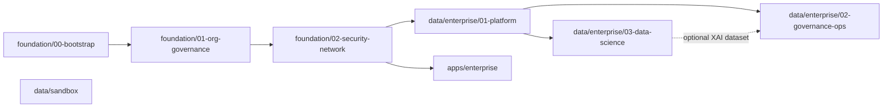

# GCP Foundation

Modular Google Cloud landing zone and Medallion data platform deployed with Terraform.

## Template Suite Overview


`gcp-foundation` owns **Layer 01**: folders, IAM, 38 Org Policies, KMS keys, and Shared VPC networking.
It also sets up VPC Service Controls, Security Command Center, and locked audit log sinks.

| Repository | Lifecycle | Responsibility | Status |
| --- | --- | --- | --- |
| [gcp-launchpad](https://github.com/choo737/gcp-launchpad) | Intake | Suite overview, architecture router, and `platform-context.json` handoff | Active |
| **gcp-foundation** *(this repo)* | Day 0-2 | WIF bootstrap, folders, 38 Org Policies, KMS, VPC, SCC, BigQuery, Dataform, XAI | Active |
| [gcp-data-ingestion](https://github.com/choo737/gcp-data-ingestion) | Day 10+ | Pub/Sub streaming, Datastream CDC, Cloud Run batch ELT, and Cloud Workflows | Active |
| [gcp-data-medallion](https://github.com/choo737/gcp-data-medallion) | Continuous | Dataform SQLX Bronze, Silver SCD2, Gold marts, and Dataplex quality specs | Active |
| [gcp-data-science](https://github.com/choo737/gcp-data-science) | Day 15+ | Regulated ML pipelines, custom SHAP containers, model gates, and XAI drift ops | Active |
| `gcp-webapp` | Planned | Regional or multi-region HA web app with Cloud Armor and Cloud SQL | Roadmap |
| `gcp-adk-agent` | Planned | Production Google ADK agent on Agent Engine or Cloud Run with evaluation | Roadmap |

## Create Your Private Repository (Do Not Fork Publicly)

GitHub forces standard forks of public repositories to stay public.
Pull requests in public forks also target the upstream public repo by default.
Click **Use this template** on GitHub or run:

```bash
gh repo create acme-corp/gcp-foundation --private --template choo737/gcp-foundation --clone
```

## Architecture & Capabilities

### Folder Topology

Deployed Google Cloud Resource Manager folder, project, and team ownership tree:

```text
organizations/<org_id> (or folders/<parent_id>)
├── shared-infrastructure [Folder] (CloudOps Admins)
│   ├── <prefix>-<suffix>-audit [Project] (CloudOps Admins / Security Admins)
│   ├── <prefix>-<suffix>-cmn-secops [Project] (SecOps Analysts)
│   ├── <prefix>-<suffix>-cmn-finops [Project] (FinOps Admins)
│   └── <prefix>-<suffix>-cmn-backup [Project] (CloudOps Admins)
└── environments [Folder]
    └── {dev, uat, staging, prod} [Folder]
        ├── network [Folder] -> <prefix>-<suffix>-network [Project] (Network Admins)
        ├── data-platform [Folder] -> storage & compute [Folders] (Data Teams)
        ├── ai [Folder] -> ds-exp & ml-ops [Projects] (AI Teams)
        └── app [Folder] -> <app> [Folder] -> <prefix>-<suffix>-app-<key> [Project] (App Teams)
```

With company acronym `sfg` and `auto_unique_suffix = true`, Terraform creates `sfg-8a3f-cmn-finops` and `sfg-9c1d-app-orders`.



| Path | Target Scope | Stage Sequence |
| --- | --- | --- |
| Path 0: Bootstrap | Existing seed project | `foundation/00-bootstrap` |
| Path 1: Greenfield | Org or top folder | `foundation/01-org-governance` -> `foundation/02-security-network` -> `data/enterprise/01-platform` -> `data/enterprise/03-data-science` -> `data/enterprise/02-governance-ops` |
| Path 2: Brownfield | Existing `data-platform` folder | `data/enterprise/01-platform` -> `data/enterprise/03-data-science` -> `data/enterprise/02-governance-ops` |
| Path 3: Sandbox | One existing GCP project | `data/sandbox` |

- **Bootstrap & WIF**: Provisions hardened `tfstate` and `iac-outputs` buckets with soft delete plus keyless GitHub Actions WIF.
- **Org Governance & SecOps**: Deploys `environments`, locked logs, `cmn-secops`, Stage-01 CMEK, FinOps, Backup & DR, 38 Org Policies, and SCC.
- **Security & Network**: Configures HSM CMEK, Shared VPC, `data`/`ai`/`app` subnets, Cloud NGFW, `GCE_FIREWALL` tags, PSC, and VPC-SC.
- **Enterprise Data & Apps**: Separates governance, storage, compute, AI (`03-data-science`), and isolated app projects (`apps/enterprise`).

## 6-Step Enterprise Operationalization

Follow [docs/05-enterprise-operationalization-guide.md](docs/05-enterprise-operationalization-guide.md) and [QUESTIONNAIRE.md](QUESTIONNAIRE.md) to deploy end to end.
Import optional gitignored `platform-context.json` from [gcp-launchpad](https://github.com/choo737/gcp-launchpad) when available.

1. **Day 0 Bootstrap**: Create a private repo, configure [CODEOWNERS](CODEOWNERS) and GitHub Environments, and apply `foundation/00-bootstrap`.
2. **Day 1A Org Governance**: Complete [QUESTIONNAIRE.md](QUESTIONNAIRE.md) and apply `foundation/01-org-governance` for folders, audit locks, budgets, and SCC.
3. **Day 1B Network & KMS**: Link stage outputs and apply `foundation/02-security-network` per environment (`dev`, `staging`, `prod`).
4. **Day 1C Data Platform & Export**: Apply `01-platform`, optional `03-data-science`, and `02-governance-ops`, then export non-sensitive outputs to GCS via `link-stages.sh`.
5. **Day 2 Extend Domains & Scans**: Add `domain_marts` in `01-platform` and declarative `additional_quality_scans` or slot overrides in `02-governance-ops`.
6. **Day 2 Operate & Decommission**: Query BigQuery SCC findings, run `drift-safe-apply`, and follow `docs/04-multi-env-and-decommission.md` for teardown.

```bash
export TFSTATE_BUCKET="<prefix>-<suffix>-tfstate"
export ENV="dev"

./scripts/link-stages.sh --env "${ENV}" foundation/01-org-governance foundation/02-security-network
make apply STAGE="foundation/02-security-network" ENV="${ENV}" TFSTATE_BUCKET="${TFSTATE_BUCKET}"

./scripts/link-stages.sh --env "${ENV}" --export-gcs "gs://<iac-outputs-bucket>/foundation-outputs.json" \
  foundation/02-security-network data/enterprise/01-platform data/enterprise/03-data-science data/enterprise/02-governance-ops
```

## AI Coding Agent Quickstart

### Antigravity or OpenAI Codex

```text
Read AGENTS.md, QUESTIONNAIRE.md, and .agents/skills/setup-customer-foundation/SKILL.md.
Check platform-context.json first, confirm Path 0-3, and write gitignored custom.auto.tfvars or tracked envs/<env>.tfvars.
```

### Claude Code

```text
Read CLAUDE.md, QUESTIONNAIRE.md, and .agents/skills/setup-customer-foundation/SKILL.md.
Create a private template repo first, link stages with scripts/link-stages.sh, and verify Dataform and Dataplex scans.
```

| Skill | File | Purpose |
| --- | --- | --- |
| `setup-customer-foundation` | `.agents/skills/setup-customer-foundation/SKILL.md` | Full private repo onboarding, intake, linking, and post-deploy verification |
| `choose-entry-point` | `.agents/skills/choose-entry-point/SKILL.md` | Select Path 0-3 based on permissions and existing landing zone |
| `add-data-domain` | `.agents/skills/add-data-domain/SKILL.md` | Add Gold domain projects and re-link `01-platform` to `02-governance-ops` |
| `add-workload-pillar` | `.agents/skills/add-workload-pillar/SKILL.md` | Onboard new workload folders across `environments` or directly under `parent_id` |
| `drift-safe-apply` | `.agents/skills/drift-safe-apply/SKILL.md` | Link outputs, inspect plans, and import pre-existing resources safely |

## CI/CD Workflows

- `.github/workflows/ci.yml`: Runs `make fmt-check`, `make validate`, and `make test` offline on every push and pull request.
- `.github/workflows/terraform-deploy.yml`: Runs offline validation on PRs and promotes `dev`, `staging`, and `prod` via scoped keyless GitHub OIDC WIF.

## Repository Layout

- `assets/`: Cloud City Layer 01 visual architecture animations.
- `modules/foundation/`: Reusable five-file modules (`folder-hierarchy`, `project-factory`, `logging-guardrails`, `finops-governance`, `backup-dr`, `network-security`, `github-wif`, `monitoring-alerts`, `scc-secops`).
- `modules/data/`: Reusable five-file modules (`governance-catalog`, `bigquery-dataset`, `bigquery-reservations`, `dataplex-scans`, `dataform-repository`, `ml-governance`).
- `modules/app/`: Reusable five-file application factory module (`workload-factory`).
- `foundation/`: Runnable stages `00-bootstrap`, `01-org-governance`, and `02-security-network` with `envs/` templates.
- `apps/enterprise/`: Per-environment application team project factory with `envs/` templates.
- `data/sandbox/`: Single-project Medallion deployment root for rapid validation.
- `data/enterprise/`: Three-stage enterprise data platform (`01-platform`, `02-governance-ops`, and optional `03-data-science`) with `envs/` templates.
- `scripts/`: `link-stages.sh` for stage linking plus `configure-bq-dr-replica.sh` and `verify-scc-detectors.sh` for Day-2 ops.
- `QUESTIONNAIRE.md`: Tier-2 intake form mapping compliance, SCC, VPC-SC, FinOps, and slot choices to `.tfvars`.
- `CODEOWNERS`: Enforces `@choo737` review ownership across foundation, data, module, and workflow paths.
- `docs/`: Architecture, entry points, decommission playbook, and enterprise operationalization guide.
- `tests/`: Python unit tests checking symmetry, anti-leak rules, Terraform safety, SCC wiring, and operational readiness.

## Quick Verification

```bash
make fmt-check
make validate
make test
```

## Documentation Index

- [GCP Launchpad Suite Router](https://github.com/choo737/gcp-launchpad)
- [Tier-2 Foundation and Data Platform Questionnaire](QUESTIONNAIRE.md)
- [Architecture Overview](docs/01-architecture.md)
- [Entry Points Guide](docs/02-entry-points.md)
- [Security Foundations Blueprint](docs/03-security-foundations-blueprint.md)
- [Multi-Environment Rollout and Decommissioning](docs/04-multi-env-and-decommission.md)
- [Enterprise Operationalization Guide](docs/05-enterprise-operationalization-guide.md)

## License

Apache License 2.0. See [LICENSE](LICENSE).
