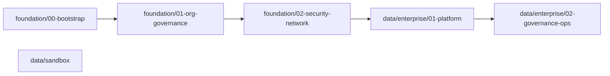

# GCP Foundation

Modular Google Cloud landing zone and Medallion data platform deployed with Terraform.

## Template Suite Overview

This repository provides Day-0 and Day-1 infrastructure inside the four-repository `choo737` accelerator suite.

| Repository | Lifecycle | Responsibility | Status |
| --- | --- | --- | --- |
| [gcp-launchpad](https://github.com/choo737/gcp-launchpad) | Intake | Suite overview, architecture router, and `platform-context.json` handoff | Active |
| **gcp-foundation** *(this repo)* | Day 0-2 | WIF bootstrap, folders, 36 Org Policies, KMS, VPC, SCC, BigQuery, Dataform | Active |
| [gcp-data-ingestion](https://github.com/choo737/gcp-data-ingestion) | Day 10+ | Pub/Sub streaming, Datastream CDC, Cloud Run batch ELT, and Cloud Workflows | Active |
| [gcp-data-medallion](https://github.com/choo737/gcp-data-medallion) | Continuous | Dataform SQLX Bronze, Silver SCD2, Gold marts, and Dataplex quality specs | Active |
| `gcp-webapp` | Planned | Regional or multi-region HA web app with Cloud Armor and Cloud SQL | Roadmap |
| `gcp-adk-agent` | Planned | Production Google ADK agent on Agent Engine or Cloud Run with evaluation | Roadmap |

## Create Your Private Repository (Do Not Fork Publicly)

GitHub forces standard forks of public repositories to stay public.
Pull requests in public forks also target the upstream public repo by default.
Click **Use this template** on GitHub or run:

```bash
gh repo create acme-corp/gcp-foundation --private --template choo737/gcp-foundation --clone
```

## Architecture & Capabilities



| Path | Target Scope | Stage Sequence |
| --- | --- | --- |
| Path 0: Bootstrap | Existing seed project | `foundation/00-bootstrap` |
| Path 1: Greenfield | Org or top folder | `foundation/01-org-governance` -> `foundation/02-security-network` -> `data/enterprise/01-platform` -> `data/enterprise/02-governance-ops` |
| Path 2: Brownfield | Existing `data-platform` folder | `data/enterprise/01-platform` -> `data/enterprise/02-governance-ops` |
| Path 3: Sandbox | One existing GCP project | `data/sandbox` |

- **Bootstrap & WIF**: Provisions hardened `tfstate` and `iac-outputs` buckets plus repo-scoped keyless GitHub Actions WIF.
- **Org Governance & SecOps**: Deploys `02-environments`, locked audit logs (`2555` days), liens, FinOps budgets, 36 Org Policies, and SCC (`NONE`/`STANDARD`/`PREMIUM`).
- **Security & Network**: Configures HSM CMEK, Shared VPC, Flow Logs, DNS logging, Datastream PSC, and staged VPC-SC.
- **Enterprise Data Platform**: Separates governance, core storage, domain Gold marts, ETL compute, and BI compute with BigQuery slots.

## 6-Step Enterprise Operationalization

Follow [docs/05-enterprise-operationalization-guide.md](docs/05-enterprise-operationalization-guide.md) and [QUESTIONNAIRE.md](QUESTIONNAIRE.md) to deploy end to end.
Import optional gitignored `platform-context.json` from [gcp-launchpad](https://github.com/choo737/gcp-launchpad) when available.

1. **Day 0 Bootstrap**: Create a private repo, configure [CODEOWNERS](CODEOWNERS) and GitHub Environments, and apply `foundation/00-bootstrap`.
2. **Day 1A Org Governance**: Complete [QUESTIONNAIRE.md](QUESTIONNAIRE.md) and apply `foundation/01-org-governance` for folders, audit locks, budgets, and SCC.
3. **Day 1B Network & KMS**: Link stage outputs and apply `foundation/02-security-network` per environment (`dev`, `staging`, `prod`).
4. **Day 1C Data Platform & Export**: Apply `01-platform` and `02-governance-ops`, then export non-sensitive outputs to GCS via `link-stages.sh`.
5. **Day 2 Extend Domains & Scans**: Add `domain_marts` in `01-platform` and declarative `additional_quality_scans` or slot overrides in `02-governance-ops`.
6. **Day 2 Operate & Decommission**: Query BigQuery SCC findings, run `drift-safe-apply`, and follow `docs/04-multi-env-and-decommission.md` for teardown.

```bash
export TFSTATE_BUCKET="<prefix>-<suffix>-tfstate"
export ENV="dev"

./scripts/link-stages.sh --env "${ENV}" foundation/01-org-governance foundation/02-security-network
make apply STAGE="foundation/02-security-network" ENV="${ENV}" TFSTATE_BUCKET="${TFSTATE_BUCKET}"

./scripts/link-stages.sh --env "${ENV}" --export-gcs "gs://<iac-outputs-bucket>/foundation-${ENV}.json" \
  foundation/02-security-network data/enterprise/01-platform data/enterprise/02-governance-ops
```

## AI Coding Agent Quickstart

### Antigravity or OpenAI Codex

```text
Read AGENTS.md, QUESTIONNAIRE.md, and .agents/skills/setup-customer-foundation/SKILL.md.
Check for gitignored platform-context.json first, confirm Path 0-3, and write gitignored custom.auto.tfvars or envs/<env>.tfvars.
```

### Claude Code

```text
Read CLAUDE.md, QUESTIONNAIRE.md, and .agents/skills/setup-customer-foundation/SKILL.md.
Create a private template repo first, link stages with scripts/link-stages.sh, and verify Dataform and Dataplex scans.
```

| Skill | File | Purpose |
| --- | --- | --- |
| `setup-customer-foundation` | `.agents/skills/setup-customer-foundation/SKILL.md` | Full private repo onboarding, intake, linking, and post-deploy verification |
| `choose-entry-point` | `.agents/skills/choose-entry-point/SKILL.md` | Select Path 0-3 based on permissions and existing landing zone |
| `add-data-domain` | `.agents/skills/add-data-domain/SKILL.md` | Add Gold domain projects and re-link `01-platform` to `02-governance-ops` |
| `add-workload-pillar` | `.agents/skills/add-workload-pillar/SKILL.md` | Onboard new workload folders across `02-environments` or `02-workloads` |
| `drift-safe-apply` | `.agents/skills/drift-safe-apply/SKILL.md` | Link outputs, inspect plans, and import pre-existing resources safely |

## CI/CD Workflows

- `.github/workflows/ci.yml`: Runs `make fmt-check`, `make validate`, and `make test` offline on every push and pull request.
- `.github/workflows/terraform-deploy.yml`: Runs offline validation on PRs and promotes `dev`, `staging`, and `prod` via scoped keyless GitHub OIDC WIF.

## Repository Layout

- `modules/foundation/`: Reusable five-file modules (`folder-hierarchy`, `project-factory`, `logging-guardrails`, `finops-governance`, `network-security`, `github-wif`, `monitoring-alerts`, `scc-secops`).
- `modules/data/`: Reusable five-file modules (`governance-catalog`, `bigquery-dataset`, `bigquery-reservations`, `dataplex-scans`, `dataform-repository`).
- `foundation/`: Runnable stages `00-bootstrap`, `01-org-governance`, and `02-security-network` with `envs/` templates.
- `data/sandbox/`: Single-project Medallion deployment root for rapid validation.
- `data/enterprise/`: Two-stage enterprise data platform (`01-platform` and `02-governance-ops`) with `envs/` templates.
- `scripts/link-stages.sh`: Links Terraform outputs locally or via GCS into `00_linked.auto.tfvars.json` with `--env` support.
- `QUESTIONNAIRE.md`: Tier-2 intake form mapping compliance, SCC, VPC-SC, FinOps, and slot choices to `.tfvars`.
- `CODEOWNERS`: Enforces `@choo737` review ownership across foundation, data, module, and workflow paths.
- `docs/`: Architecture, entry points, Cloudera mapping, decommission playbook, and enterprise operationalization guide.
- `tests/`: Python unit tests checking symmetry, anti-leak rules, Terraform safety, SCC wiring, and operational readiness.

## Quick Verification

```bash
make fmt-check
make validate
make test
```

## Documentation Index

- [GCP Launchpad Suite Router](https://github.com/choo737/gcp-launchpad)
- [Tier-2 Foundation and Data Platform Questionnaire](QUESTIONNAIRE.md)
- [Architecture Overview](docs/01-architecture.md)
- [Entry Points Guide](docs/02-entry-points.md)
- [Cloudera to BigQuery Mapping](docs/03-cloudera-to-bigquery.md)
- [Multi-Environment Rollout and Decommissioning](docs/04-multi-env-and-decommission.md)
- [Enterprise Operationalization Guide](docs/05-enterprise-operationalization-guide.md)

## License

Apache License 2.0. See [LICENSE](LICENSE).
