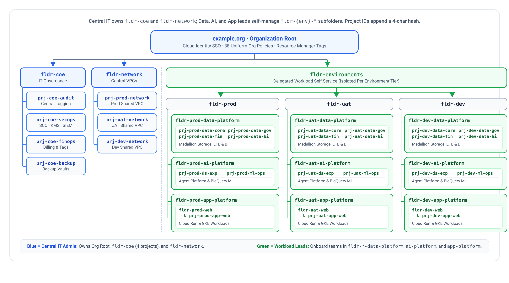
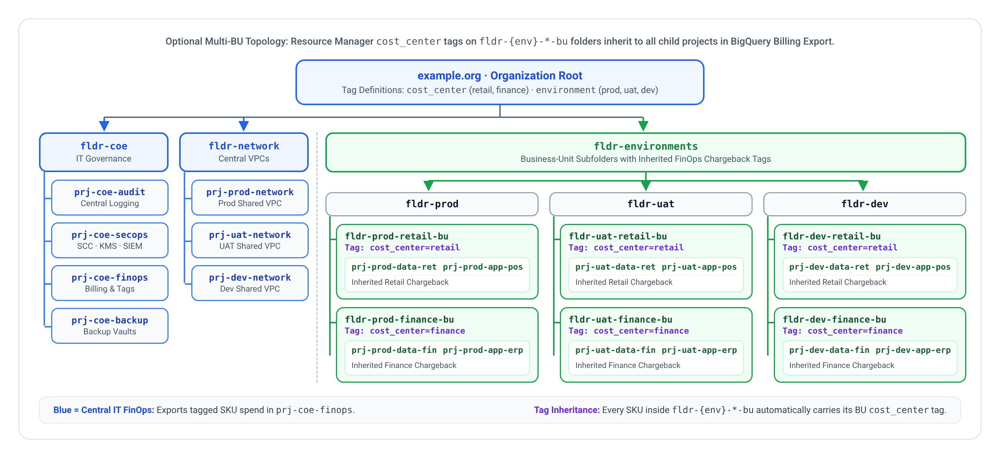

# Architecture Overview

This repository separates cloud foundation guardrails from data platform operations across independent Terraform state roots.

## Folder Topology

Deployed Google Cloud Resource Manager `[Folder]`, `[Project]`, and `(Owner Team)` tree:

## Multi-BU & Chargeback Folder Breakdown Sample

Multi-BU enterprises place business unit subfolders like `fldr-<env>-retail-bu` directly under `fldr-prod`, `fldr-uat`, and `fldr-dev` for FinOps chargeback.
Resource Manager tag bindings on each BU folder inherit down to every child project in Cloud Billing exports.

## Four-Project Default & Optional ETL Split

| Project | Layer | Responsibility |
| --- | --- | --- |
| `data-gov` | Governance | BigQuery Policy Tags taxonomy, `LAST_FOUR_CHARACTERS` masking, Knowledge Catalog glossary |
| `data-core` | Storage & ETL | Landing bucket (`incoming/`), `bronze_raw`, `silver_curated`, `assertions`, `quarantine`, AR, Dataform, ETL slots |
| `data-<domain>` | Storage | Domain-scoped `gold_mart` datasets such as `fin` |
| `data-etl` | Compute (opt-in) | Optional split ETL project (`split_etl_project = true`) |
| `data-bi` | Compute | Zero-table BI query project isolating analyst compute and billing |

Governance uses BigQuery Policy Tags (formerly Data Catalog Policy Tags) and Knowledge Catalog (formerly Dataplex).

## Cross-Stage & Cross-Repo Handoff: Day 1 Alice to Day 10 Bob

Day 1 Alice runs `gcp-foundation` to create folders, guardrails, KMS keys, networks, and BigQuery schemas.
Day 10 Bob runs `gcp-data-ingestion` to deploy Pub/Sub, Dataflow, and Datastream pipelines later.

Why avoid `terraform_remote_state` across teams and repositories?

- Terraform state stores every resource attribute, IAM binding, internal identifier, and sensitive output in plaintext JSON.
- Granting Bob read access to Alice's `tfstate` bucket leaks foundation state internals across trust boundaries.
- Changing internal resources in `gcp-foundation` also risks breaking remote state lookups in downstream repos.

How `00_linked.auto.tfvars.json` and `gs://<prefix>-iac-outputs` solve this:

- Stage 00 creates `<prefix>-<suffix>-tfstate` (locked to Alice) and `<prefix>-<suffix>-iac-outputs` (shared read-only for Bob).
- Alice runs `./scripts/link-stages.sh --env dev --export-gcs gs://<bucket>/<stage>.json <stage1> <stage2>` after apply.
- The script strips `sensitive = true` and `null` values before uploading clean JSON to GCS.
- Bob runs `./scripts/link-stages.sh --env dev --from-gcs gs://<bucket>/<stage>.json <target_stage_dir>` inside `gcp-data-ingestion`.
- The script keeps only variables declared in Bob's `variables.tf` and writes `00_linked.auto.tfvars.json` (`0600`).
- Alice's `.tfstate` remains locked inside `<prefix>-<suffix>-tfstate` at all times.

## Design Rules & Official References

- Every project disables default VPC creation (`auto_create_network = false`).
- Production projects set `deletion_policy = "PREVENT"` and folders set `deletion_protection = true`.
- Foundation stage 00 creates hardened `tfstate` and `iac-outputs` buckets with 14-day soft delete plus GitHub WIF.
- Foundation stage 01 provisions `prj-coe-finops-<suffix>` with `"US"` export for 2-month backfill and alert-only multi-tier budgets.
- See [Cloud Billing BigQuery Export Setup](https://docs.cloud.google.com/billing/docs/how-to/export-data-bigquery-setup) and [Cloud Billing Export Schema](https://docs.cloud.google.com/billing/docs/how-to/export-data-bigquery).
- Foundation stage 01 provisions optional `prj-coe-backup-<suffix>` with immutable Backup Vaults and daily GCE/Cloud SQL plans.
- Enterprise GCS landing buckets support 14-day or 30-day soft delete plus optional dual-region `ASYNC_TURBO` replication.
- See [Cloud Storage SLA](https://cloud.google.com/storage/sla) for regional, dual-region, and multi-region availability targets.
- Foundation stage 01 encrypts SCC datasets and Pub/Sub topics with Stage-01 CMEK and supports `FOLDER` or `PROJECT` scope.
- Foundation stage 01 enforces a 38-policy Org Policy baseline when `enable_org_policies = true`.
- Foundation stage 02 configures CMEK, Shared VPC, Flow Logs, DNS logging, VPC-SC, and monitoring alerts.
- Stage 02 layers folder hierarchical firewall policies, `GCE_FIREWALL` secure tags, threat intel rules, and NGFW Enterprise opt-in.
- See [Cloud NGFW Overview](https://cloud.google.com/security/products/firewall) and [Cloud NGFW Pricing](https://cloud.google.com/firewall/pricing).
- Dataform ETL uses the custom `dataform_pipeline_runner` role without dataset update or delete rights.
- BigQuery slot reservations default to `slot_capacity = 0` with `ENTERPRISE` autoscaling or `ENTERPRISE_PLUS` `secondary_location` for DR.
- No stage shares Terraform state; stages pass outputs through `scripts/link-stages.sh` into `00_linked.auto.tfvars.json`.
