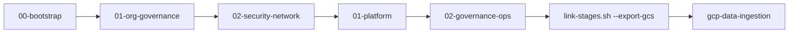

# Enterprise Operationalization Guide

This guide walks platform teams through Day-0 bootstrap, Day-1 rollout, and Day-2 operations.



## Step 1 - Day 0: Private Repo, Branch Protection & Bootstrap (`00-bootstrap`)

1. Create a private customer repository using `gh repo create --private --template choo737/gcp-foundation --clone`.
2. Review [CODEOWNERS](../CODEOWNERS) and require pull request reviews before merging to `main`.
3. Create GitHub Environments named `dev`, `staging`, and `prod` with required reviewers on `prod`.
4. Configure `foundation/00-bootstrap/custom.auto.tfvars` with `project_id`, `region`, `prefix`, and `project_suffix`.
5. Set `ci_repository_map` to scope `tf_foundation_ci`, `tf_ingestion_ci`, and `dataform_ci` per repository.
6. Apply `foundation/00-bootstrap` to provision hardened `tfstate` and `iac-outputs` Cloud Storage buckets.

```bash
terraform -chdir=foundation/00-bootstrap init
terraform -chdir=foundation/00-bootstrap apply
```

## Step 2 - Day 1A: Organization Governance & SecOps (`01-org-governance`)

1. Complete [QUESTIONNAIRE.md](../QUESTIONNAIRE.md) or read gitignored `platform-context.json` from [gcp-launchpad](https://github.com/choo737/gcp-launchpad).
2. Write answers into gitignored `foundation/01-org-governance/custom.auto.tfvars`.
3. Enable `enable_org_policies = true` to enforce all 36 folder-level Org Policies.
4. Set `retention_days = 2555`, `lock_audit_bucket = true`, and `enable_audit_project_lien = true` for regulated FSI or RMiT.
5. Enable FinOps budgets (`enable_billing_budget = true`) and tag bindings on the central audit project.
6. Select `scc_tier` (`NONE`, `STANDARD`, or `PREMIUM`) for Security Command Center v2 findings and alerts.

```bash
export TFSTATE_BUCKET="<prefix>-<suffix>-tfstate"
make apply STAGE="foundation/01-org-governance" ENV="shared" TFSTATE_BUCKET="${TFSTATE_BUCKET}"
```

## Step 3 - Day 1B: Shared VPC, CMEK & Staged VPC-SC (`02-security-network`)

1. Link stage 01 outputs into `foundation/02-security-network` for each target environment (`dev`, `staging`, `prod`).
2. Set `kms_protection_level = "HSM"` in `envs/<env>.tfvars` for regulated FSI primary and DR CMEK keys.
3. Enable Shared VPC, VPC Flow Logs, DNS logging, and Datastream Private Service Connect attachments.
4. Start with `enable_vpc_sc = true` and `enforce_vpc_sc = false` (`DRY_RUN`) to audit traffic first.
5. Review dry-run violations in Log Analytics before flipping `enforce_vpc_sc = true` for `ENFORCED` cutover.

```bash
export ENV="dev"
./scripts/link-stages.sh --env "${ENV}" foundation/01-org-governance foundation/02-security-network
make apply STAGE="foundation/02-security-network" ENV="${ENV}" TFSTATE_BUCKET="${TFSTATE_BUCKET}"
```

## Step 4 - Day 1C: Data Platform, Governance & Downstream Export (`01-platform` & `02-governance-ops`)

1. Link stage 01 and stage 02 outputs into `data/enterprise/01-platform` per environment.
2. Provision five separated data projects, BigQuery `ENTERPRISE` slot reservations, and dual PII Policy Tags (`restricted` and `masked`).
3. Link `01-platform` outputs into `data/enterprise/02-governance-ops` to deploy the Dataform repository, release configs, and Dataplex scans.
4. Export non-sensitive outputs to the shared `iac-outputs` bucket for [gcp-data-ingestion](https://github.com/choo737/gcp-data-ingestion) without exposing `.tfstate`.

```bash
./scripts/link-stages.sh --env "${ENV}" \
  foundation/01-org-governance foundation/02-security-network data/enterprise/01-platform
make apply STAGE="data/enterprise/01-platform" ENV="${ENV}" TFSTATE_BUCKET="${TFSTATE_BUCKET}"

./scripts/link-stages.sh --env "${ENV}" \
  data/enterprise/01-platform data/enterprise/02-governance-ops
make apply STAGE="data/enterprise/02-governance-ops" ENV="${ENV}" TFSTATE_BUCKET="${TFSTATE_BUCKET}"

./scripts/link-stages.sh --env "${ENV}" \
  --export-gcs "gs://<iac-outputs-bucket>/foundation-${ENV}.json" \
  foundation/02-security-network data/enterprise/01-platform data/enterprise/02-governance-ops
```

## Step 5 - Day 2: Extending Domains, Quality Scans, Slots & Workload Pillars

1. Add Gold domains such as `domain_marts = ["fin", "ret", "ops"]` in `data/enterprise/01-platform/envs/<env>.tfvars`.
2. Re-apply `01-platform`, re-link into `02-governance-ops`, and re-apply `02-governance-ops`.
3. Stage `02-governance-ops` populates `gold_<code>_project`, `gold_<code>_dataset`, and VPC-SC perimeter ingress automatically for every domain.
4. Domain code `ret` also maps `gold_retail_project` and `gold_retail_dataset` for `gcp-data-medallion`.
5. Add extra Dataplex Auto Data Quality scans declaratively using `additional_quality_scans` inside `data/enterprise/02-governance-ops/envs/<env>.tfvars`.
6. Tune `baseline_slots` and `max_slots` in `01-platform/envs/<env>.tfvars` to scale BigQuery `ENTERPRISE` reservations.
7. Add new workload folders through `workload_folders` in `foundation/01-org-governance` or per-environment folders under `02-environments`.

```hcl
# Example inside data/enterprise/02-governance-ops/envs/dev.tfvars
additional_quality_scans = {
  dim_customers_dq = {
    table_id   = "dim_customers"
    row_filter = "country_code = 'MY'"
    rules = [
      {
        name      = "customer-id-not-null"
        dimension = "COMPLETENESS"
        column    = "customer_id"
        non_null  = true
      }
    ]
  }
}
```

## Step 6 - Day 2: Drift-Safe Operations, SecOps Triage & Break-Glass Decommission

1. Run `.agents/skills/drift-safe-apply/SKILL.md` checks and inspect `terraform plan` before every shared-root apply.
2. Query regional SCC findings and audit logs inside `${prefix}_audit_logs` and `${prefix}_scc_findings` in BigQuery.
3. Follow [docs/04-multi-env-and-decommission.md](04-multi-env-and-decommission.md) before lowering deletion flags, dropping liens, or tearing down locked buckets.

```sql
SELECT category, severity, state, resource_name
FROM `<audit-project>.<prefix>_scc_findings.findings`
WHERE state = 'ACTIVE'
ORDER BY event_time DESC
LIMIT 50;
```
