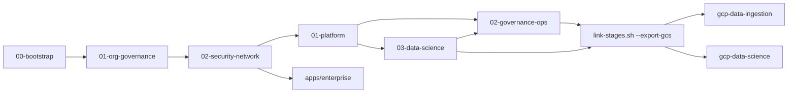

# Enterprise Operationalization Guide

This guide walks platform teams through Day-0 bootstrap, Day-1 rollout, and Day-2 operations.



## Step 1 - Day 0: Private Repo, Branch Protection & Bootstrap (`00-bootstrap`)

1. Create a private customer repository using `gh repo create --private --template choo737/gcp-foundation --clone`.
2. Review [CODEOWNERS](../CODEOWNERS) and require pull request reviews before merging to `main`.
3. Create GitHub Environments named `dev`, `uat`, and `prod` with required reviewers on `prod`.
4. Configure `foundation/00-bootstrap/custom.auto.tfvars` with `project_id`, `region`, `prefix`, and `project_suffix`.
5. Set `ci_repository_map` to scope `tf_foundation_ci`, `tf_ingestion_ci`, and `dataform_ci` per repository.
6. Apply `foundation/00-bootstrap` to provision hardened `tfstate` and `iac-outputs` Cloud Storage buckets.

```bash
terraform -chdir=foundation/00-bootstrap init
terraform -chdir=foundation/00-bootstrap apply
```

## Step 2 - Day 1A: Organization Governance & SecOps (`01-org-governance`)

1. Complete [QUESTIONNAIRE.md](../QUESTIONNAIRE.md) or read gitignored `platform-context.json` from [gcp-launchpad](https://github.com/choo737/gcp-launchpad).
2. Write answers into gitignored `foundation/01-org-governance/custom.auto.tfvars`.
3. Enable `enable_org_policies = true` to enforce all 38 org-level or folder-level Org Policies.
4. Set `retention_days = 2555`, `lock_audit_bucket = true`, `enable_audit_cmek = true`, and `enable_audit_project_lien = true` for FSI.
5. Keep `create_dedicated_finops_project = true`, configure `finops_alert_email_addresses`, and link Cloud Billing export in `"US"`.
6. Enable `enable_backup_dr = true` for immutable Backup Vaults and daily GCE and Cloud SQL schedules.
7. Select `scc_tier` (`NONE`, `STANDARD`, or `PREMIUM`) and `scc_scope` (`ORGANIZATION`, `FOLDER`, or `PROJECT`) for Security Command Center v2.

```bash
export TFSTATE_BUCKET="<prefix>-<suffix>-tfstate"
make apply STAGE="foundation/01-org-governance" ENV="shared" TFSTATE_BUCKET="${TFSTATE_BUCKET}"
```

## Step 3 - Day 1B: Shared VPC, CMEK & Staged VPC-SC (`02-security-network`)

1. Link stage 01 outputs into `foundation/02-security-network` for each target environment (`dev`, `uat`, `prod`).
2. Set `kms_protection_level = "HSM"` in `envs/<env>.tfvars` for regulated FSI primary and DR CMEK keys.
3. Enable Shared VPC, VPC Flow Logs, DNS logging, and Datastream Private Service Connect attachments.
4. Start with `enable_vpc_sc = true` and `enforce_vpc_sc = false` (`DRY_RUN`) to audit traffic first.
5. Review dry-run violations in Log Analytics before flipping `enforce_vpc_sc = true` for `ENFORCED` cutover.

```bash
export ENV="dev"
./scripts/link-stages.sh --env "${ENV}" foundation/01-org-governance foundation/02-security-network
make apply STAGE="foundation/02-security-network" ENV="${ENV}" TFSTATE_BUCKET="${TFSTATE_BUCKET}"
```

## Step 4 - Day 1C: Data, AI, Governance & Apps (`01-platform` -> `03-data-science` -> `02-governance-ops` -> `apps/enterprise`)

1. Link stage 01 and stage 02 outputs into `data/enterprise/01-platform` per environment.
2. Provision four default data projects (or five with `split_etl_project`), reservations, and dual PII Policy Tags.
3. Optional: link stage 01, stage 02, and `01-platform` into `data/enterprise/03-data-science` for Workbench and XAI.
4. Link `01-platform` (and `03-data-science` if enabled) into `data/enterprise/02-governance-ops` for Dataform and scans.
5. Optional: link stage 01 and stage 02 into `apps/enterprise` for isolated Cloud Run and GKE projects.
6. Export non-sensitive outputs to `iac-outputs` for [gcp-data-ingestion](https://github.com/choo737/gcp-data-ingestion) and [gcp-data-science](https://github.com/choo737/gcp-data-science) without `.tfstate`.

```bash
./scripts/link-stages.sh --env "${ENV}" \
  foundation/01-org-governance foundation/02-security-network data/enterprise/01-platform
make apply STAGE="data/enterprise/01-platform" ENV="${ENV}" TFSTATE_BUCKET="${TFSTATE_BUCKET}"

./scripts/link-stages.sh --env "${ENV}" \
  foundation/01-org-governance foundation/02-security-network data/enterprise/01-platform data/enterprise/03-data-science
make apply STAGE="data/enterprise/03-data-science" ENV="${ENV}" TFSTATE_BUCKET="${TFSTATE_BUCKET}"

./scripts/link-stages.sh --env "${ENV}" \
  data/enterprise/01-platform data/enterprise/03-data-science data/enterprise/02-governance-ops
make apply STAGE="data/enterprise/02-governance-ops" ENV="${ENV}" TFSTATE_BUCKET="${TFSTATE_BUCKET}"

./scripts/link-stages.sh --env "${ENV}" \
  foundation/01-org-governance foundation/02-security-network apps/enterprise
make apply STAGE="apps/enterprise" ENV="${ENV}" TFSTATE_BUCKET="${TFSTATE_BUCKET}"

./scripts/link-stages.sh --env "${ENV}" \
  --export-gcs "gs://<iac-outputs-bucket>/foundation-outputs.json" \
  foundation/02-security-network data/enterprise/03-data-science data/enterprise/01-platform data/enterprise/02-governance-ops
```

## Step 5 - Day 2: Extending Domains, Quality Scans, Slots & Workload Pillars

1. Add Gold domains such as `domain_marts = ["fin", "ret", "ops"]` in `data/enterprise/01-platform/envs/<env>.tfvars`.
2. Re-apply `01-platform`, re-link into `02-governance-ops`, and re-apply `02-governance-ops`.
3. Stage `02-governance-ops` populates `gold_<code>_project`, `gold_<code>_dataset`, and VPC-SC perimeter ingress automatically for every domain.
4. Domain code `ret` also maps `gold_retail_project` and `gold_retail_dataset` for `gcp-data-medallion`.
5. Add extra Knowledge Catalog Auto data quality scans using `additional_quality_scans` inside `data/enterprise/02-governance-ops/envs/<env>.tfvars`.
6. Tune `baseline_slots` and `max_slots` in `01-platform/envs/<env>.tfvars` to scale BigQuery `ENTERPRISE` reservations.
7. Add per-environment workload folders under `fldr-environments/fldr-<env>` in `modules/foundation/folder-hierarchy` or directly under `parent_id`.

```hcl
# Example inside data/enterprise/02-governance-ops/envs/dev.tfvars
additional_quality_scans = {
  dim_customers_dq = {
    table_id   = "dim_customers"
    row_filter = "country_code = 'MY'"
    rules = [
      {
        name      = "customer-id-not-null"
        dimension = "COMPLETENESS"
        column    = "customer_id"
        non_null  = true
      }
    ]
  }
}
```

## Step 6 - Day 2: Drift-Safe Operations, SecOps Triage & Break-Glass Decommission

1. Run `.agents/skills/drift-safe-apply/SKILL.md` checks and inspect `terraform plan` before every shared-root apply.
2. Query regional SCC findings and audit logs inside `${prefix}_audit_logs` and `${prefix}_scc_findings` in BigQuery.
3. Run `./scripts/verify-scc-detectors.sh --org <org_id>` to verify active ETD, VM, Container, and Cloud Run detectors.
4. Run `./scripts/configure-bq-dr-replica.sh --project <id> --dataset <id> --replica-location <dr_region>` to replicate BigQuery datasets.
5. Follow [docs/04-multi-env-and-decommission.md](04-multi-env-and-decommission.md) before lowering deletion flags, dropping liens, or tearing down locked buckets.

```sql
SELECT category, severity, state, resource_name
FROM `<audit-project>.<prefix>_scc_findings.findings`
WHERE state = 'ACTIVE'
ORDER BY event_time DESC
LIMIT 50;
```
